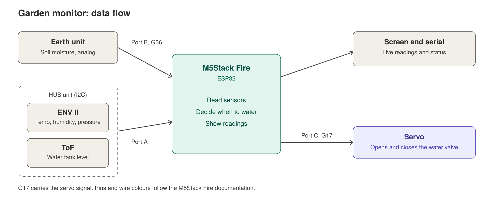

# Wiring notes

How the garden monitor is connected. Anything marked TODO is not built or verified yet. Only mark a row as verified after testing it on the real hardware.

## Overview

TODO: add a photo of the whole setup, saved as `docs/images/overview.jpg`.

## Fire port map

| Port | Colour | Pins | Connected to | Status |
|---|---|---|---|---|
| Port A | Red | G21 (SDA), G22 (SCL) | HUB unit with ENV II and ToF | Works (I2C scan and ENV II readings) |
| Port B | Black | G26, G36 | Earth unit, analog output on G36 | Works (raw readings on the screen) |
| Port C | Blue | G17, G16 | Servo, signal on G17 | Works (sweep test, 2026-11-13) |

Pin numbers and Grove wire colours come from M5Stack's Fire documentation (docs.m5stack.com/en/core/Fire). Black is GND and red is 5V on every port. The signal wires are: Port A yellow G21 and white G22, Port B yellow G26 and white G36, Port C yellow G17 and white G16. The servo test confirms the G17 signal on Port C.

## I2C devices

| Unit | Typical address | Verified with scan |
|---|---|---|
| ENV II (SHT30 and BMP280) | 0x44 and 0x76 | Yes, both found (2026-11-12) |
| ToF | 0x29 | Yes, found (2026-11-12) |

The scan (`firmware/i2c_scan`) also lists 0x10, 0x68 and 0x75. These sit on the Fire's own internal bus, not on the external units.

## Sensor behaviour

| Unit | Output | Reading | Calibration |
|---|---|---|---|
| Earth | Analog voltage on G36 | Raw 0 to 4095 | Dry in air: 4095. In water: about 2020 (hovers 2010 to 2030). Damp soil: TODO. Provisional dry threshold: raw 3300, about 38% of the dry-to-water range (a guess, to tune in real soil) |
| ENV II | I2C | Temperature, humidity, pressure | None |
| ToF | I2C | Distance in mm to water surface | Using guesses of 50 mm full and 200 mm empty until the tank is built |

## Data flow

## Servo valve

The servo opens and closes a soft tube on a gravity-fed water tank. It is controlled from Port C.

| Servo wire | Connects to |
|---|---|
| Brown (ground) | GND, black Grove wire |
| Red | 5V, red Grove wire |
| Orange (signal) | G17, yellow Grove wire |

Notes:

- The servo sweep test (`firmware/servo_test`) moves the servo between two angles every 1.5 seconds.
- If the Fire resets when the servo moves, use a separate 5 V supply for the servo and join its ground to the Fire's GND.
- The servo swings only between about 20 and 100 degrees in the test, to avoid straining the end stops.
- Keep the arm clear of the Lego frame at both ends of the swing. A servo pushing against the frame draws far more current and can reset the Fire (see the build log, Stage 5).
- TODO: Lego valve arm and tank mount, with a photo saved as `docs/images/valve.jpg`.

## Optional: pump instead of servo (not built)

A DC pump needs a transistor switch, because a Fire pin cannot supply the current. Parts: 2N3904, 1 kΩ resistor, 1N4007 diode, DC motor or small pump, separate battery pack.

| From | To |
|---|---|
| Fire G17 (Port C signal) | 1 kΩ resistor, then 2N3904 base |
| 2N3904 emitter | Common GND rail |
| 2N3904 collector | Motor wire 1 |
| Motor wire 2 | Battery pack positive |
| 1N4007 | Across the motor, stripe toward positive |
| Fire GND (Port C black wire) | Common GND rail |
| Battery pack negative | Common GND rail |

The motor never connects to a Fire pin directly, the motor supply is separate from the Fire's USB power, and the 2N3904 is rated for about 200 mA.

## Test log

| Date | What I tested | Result |
|---|---|---|
| 2026-11-12 | hello_fire sketch: screen and buttons | TODO |
| 2026-11-13 | env_ii_test: ENV II through the HUB on Port A | Works: 23.7 C, 57.6 %, 1007.5 hPa |
| 2026-11-13 | earth_calibration: Earth unit on Port B | Dry 4095, water about 2020 |
| 2026-11-13 | servo_test: servo sweep on Port C | Works |
| 2026-11-13 | tof_test: ToF through the HUB on Port A | Works: distance changes with my hand, out of range shows when far |
| 2026-11-13 | water_level_warning: ToF distance to tank level, red screen when low | Works |
| 2026-11-13 | watering_logic: Earth unit on Port B, servo on Port C | Works: opens in air, stays shut in water, cooldown runs |

## Safety

- Low-voltage DC only. No AC motor in this project.
- Keep water and electronics apart. The Fire, wiring and servo sit above and away from the plot and tank.
- For the optional pump, connect the motor supply last, after checking every other wire.

## Lessons

TODO: add what went wrong and how it was fixed.
